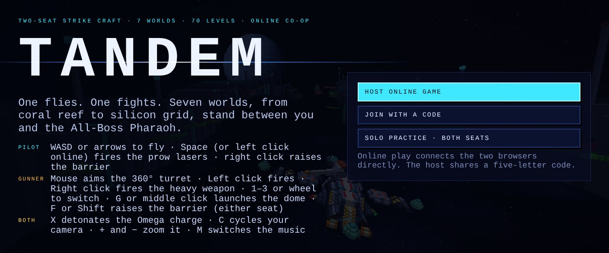
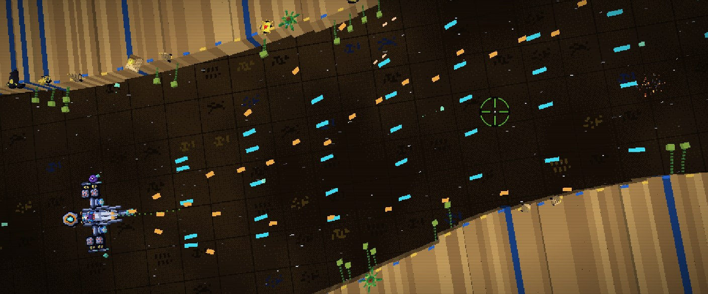
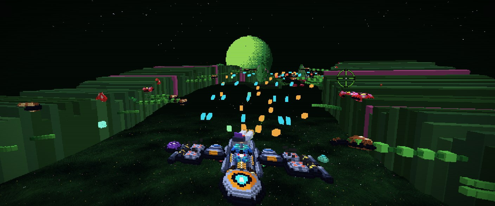
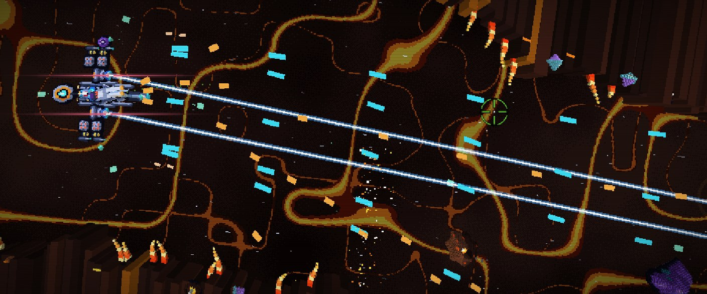
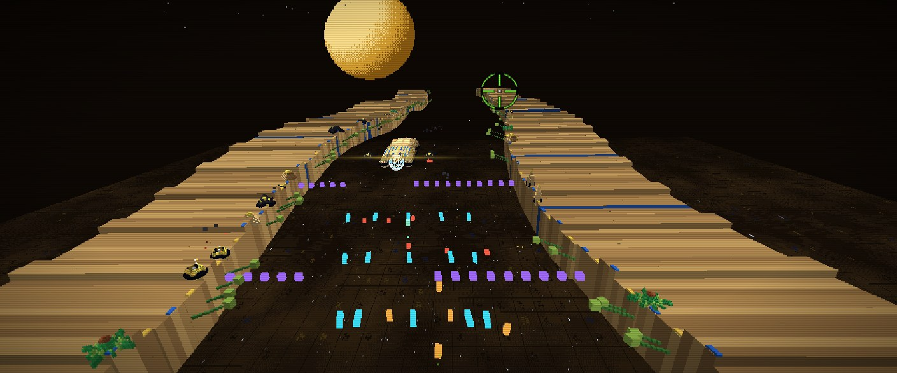
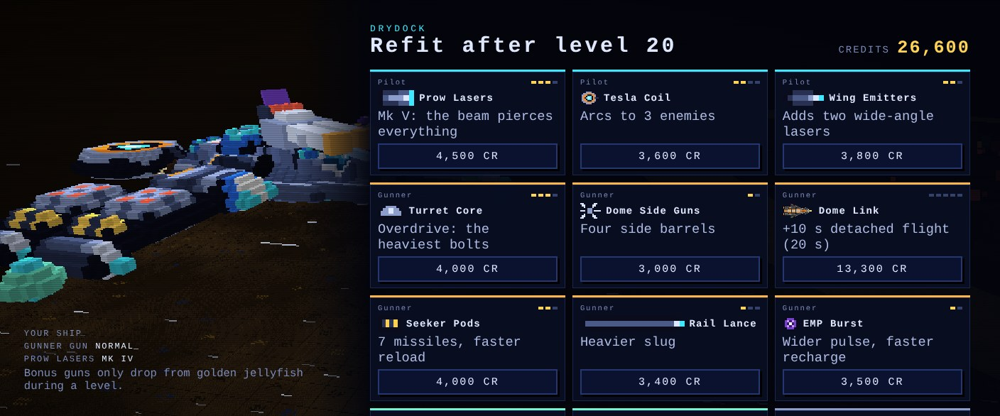
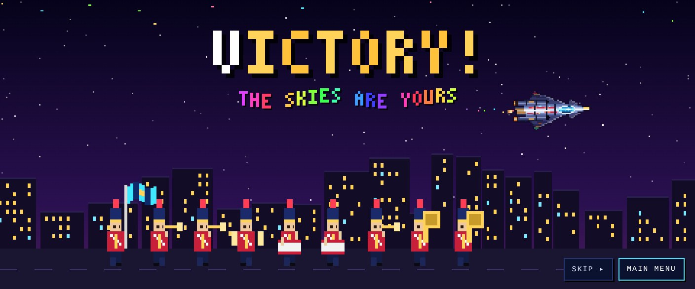
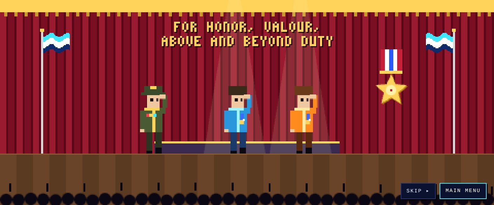
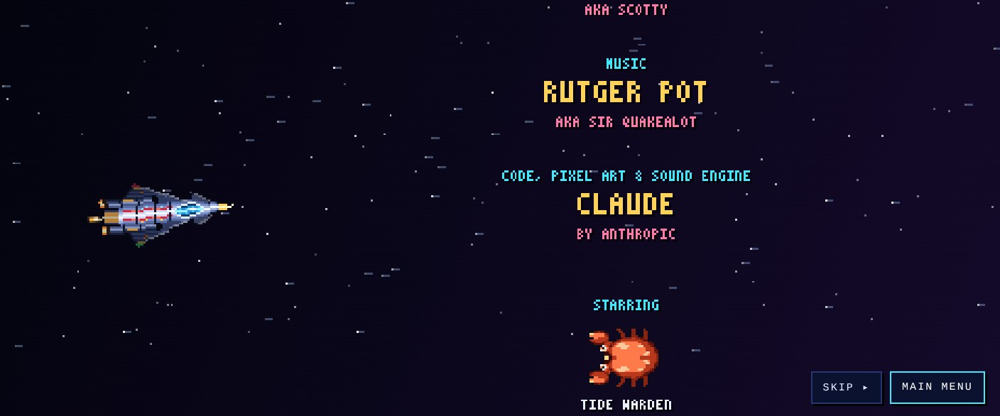

# Tandem

A two-player online co-op shooter in pixel-art 3D. One player is the **pilot**, the other is the **gunner**. Together you fly one ship through **70 levels in seven themed worlds**, from a coral reef to a silicon grid, and finally face the All-Boss Pharaoh.

**Play:** https://endless1977.github.io/Tandem/

| | |
|---|---|
|  |  |
| *Valley of Ra: the road winds across the screen* | *Chase view: the road climbs, dips and curves* |
|  |  |
| *Fully equipped ship firing its Side Beams* | *Boss arena: boss at the top, ship at the bottom* |
|  |  |
| *The drydock after every boss* | *The ending: victory fanfare* |
|  |  |
| *For honor, valour, above and beyond duty* | *Rolling credits* |

## Playing online

1. The host clicks **Host online game**, picks a seat (pilot or gunner), a start level and a difficulty, then clicks **Open room**.
2. The host shares the five-letter code, or the invite link (`…/?join=CODE`).
3. The other player clicks **Join with a code** (or opens the link) and joins.
4. The host clicks **Launch**.

The two browsers connect directly (PeerJS / WebRTC). The host's browser runs the game, so the host should keep the tab open and in front. A guest pilot flies without input lag, because the guest's ship movement is predicted locally. If a partner drops out, the host can continue solo with both seats.

**Solo practice** lets one player handle both seats, and can start at any boss level with starting credits.

## Controls

| Seat | Control | Action |
|---|---|---|
| Pilot | WASD / arrows | Fly |
| Pilot | Space (or left click when online) | Prow lasers, plus the Tesla Coil if bought |
| Pilot | Right click (online) | Barrier field |
| Gunner | Mouse | Aim the 360° turret (green crosshair) |
| Gunner | Left click | Rapid-fire laser turret |
| Gunner | Right click | Heavy weapon (Seekers, Rail Lance, EMP) |
| Gunner | 1–3, wheel | Switch heavy weapon |
| Gunner | G / middle click | Launch or recall the dome |
| Both | F / Shift | Barrier field |
| Both | X | Detonate the Omega charge (if bought) |
| Both | C | Cycle your own camera |
| Both | + / − (or Ctrl + wheel) | Zoom your camera in or out |
| Both | M | Music on/off |
| Both | H (or the Art button) | Switch between HD art and the original pixel art |

### Cameras

Each player picks a view independently: **Anamorphic** (default, the classic 2.4:1 top view), **Chase** (behind the ship), **Hull top**, **Cockpit** and **Gunner seat** (looks along the turret; click to lock the mouse). In every view except Anamorphic, W/S move forward/back and A/D move sideways.

## Structure

- **Seven worlds of ten levels.** A mini-boss waits at level 5 of every world and the world's end boss at level 10. The next theme only begins after you beat the end boss.
- **The road winds.** It curves across the screen and rises and falls like a roller coaster, and the camera follows and tilts with it. The game logic stays straight, so what you see is what you hit.
- **Boss fights** flatten the road and swing the default camera behind the ship: boss at the top, ship at the bottom. W/S then move forward and back. Every other camera still works. End bosses have a lot of stamina, and the big ones need their shield pods destroyed first.
- **Level 70** is the All-Boss Pharaoh (the Null Sovereign). It has two lives: time freezes while it transforms, and its second form attacks faster and harder.
- **A drydock after every boss**, where both players spend shared credits on upgrades and both press Ready. On game over you retry from the last drydock and keep your upgrades and credits.

### Worlds

| World | Theme | You meet | Mini-boss | End boss |
|---|---|---|---|---|
| I | Coral Deep (water) | squid, jellyfish, urchins, eels, mantas | Nautilus Prime | Tide Warden, a giant crab |
| II | Valley of Ra (Egypt) | scarabs, eyes of Horus, sun disks, Bastet cats, falcons, cobras; pyramids, obelisks, ankhs | Eye of Horus | Sphinx of Ra |
| III | Bleached Dunes (desert) | vultures, tumbleweeds, tortoises, rattlesnakes, sandworms; cacti, horse skeletons, wells | Sandshell Titan | Dune Scorpion |
| IV | Magma Rift (lava) | fire bats, flame wisps, phoenixes, crystal eyes; volcanoes, stalagmites, stalactites, crystals | Cinder Phoenix | Magma Colossus |
| V | Emerald Canopy (jungle) | dragonflies, dart frogs, long-tailed monkeys, chameleons, anacondas; lianas, poison flowers | Canopy Stalker | Corpse Bloom |
| VI | Silicon Grid (digital) | cursors, floppies, CPU fans, virus bugs, a snake from the snake game; RAM, CPUs, RGB strips | Kernel Daemon | Mainframe Argus |
| VII | Sovereign's Throne | all worlds torn together | Throne Herald | The All-Boss Pharaoh |

The walls also hold seaweed, geysers that erupt every few seconds, and grabbing kelp that holds the ship and drains it until you shoot it free.

### Difficulty

Choose **Normal**, **Hard** or **Extreme** next to the start level. On Hard and Extreme, the further you get, the more often enemies dodge your shots (a blue MISS) and the harder their weapons hit. Your own ship stays the same.

## Weapons and upgrades

Every upgrade bolts a visible part onto the ship. The modules click onto the hull and onto each other: Side Beam cannons against the hull, then the square AA boxes, then the Seeker Pods, then the wing emitters, with the round EMP cylinder on the left end. The ship gets wider with every module, but only the hull itself can be hit.

| Seat | Upgrade | What it does |
|---|---|---|
| Pilot | Prow Lasers Mk II–V | Thicker beams, heavier hits; Mk V pierces |
| Pilot | Tesla Coil (4 levels) | A coil on the tail zaps the nearest enemy in short range while the prow fires; the lightning chains to up to 4 enemies |
| Pilot | Wing Emitters | Extra side and angled lasers from the outer modules |
| Gunner | Turret Core, Dome Side Guns | Bigger dome, thicker bolts, twin and side barrels |
| Gunner | Dome Link | Detach the turret dome (see below); +10 s per purchase, costs at least half your credits |
| Gunner | Seeker Pods, Rail Lance, EMP Burst | Heavy weapons on right click |
| Auto | Side Beams (5 levels) | Two wing cannons fire forward laser beams every few seconds; thin at first, as wide as the cannon's muzzle at level 5 |
| Auto | AA Battery | Homing missiles that launch on their own |
| Auto | Nova Orbs | Slow orbs that destroy any creature or shot they touch, up to 12 firing points |
| Defense | Sonic Shield (3 levels) | Passively bounces 50 / 65 / 80% of enemy shots off the hull; bounced shots hurt enemies |
| Defense | Barrier, Deflectors, Hull Plating, Wing Drones | Shields, armour and escorts |
| Supply | Omega Charge, Field Repair, Spare Hull | Clear the screen once, repair, extra ship |

Credits come from kills, and every cleared level pays a fixed bonus on top.

**Detachable dome:** with Dome Link the gunner can launch the turret dome (G or middle click). It rides a small armoured copy of the ship, flies to the crosshair, keeps shooting, and rams anything it touches: two passes kill an ordinary creature. It stays out 10 seconds plus 10 per Dome Link level, then flies home to recharge. If the ship is destroyed, the dome goes with it.

### Bonus jellyfish and gunner guns

Golden jellyfish drift through now and then. Shoot one and it drops a bonus block for the pilot to fly into:

- **Gunner gun blocks** cycle through colours and letters: **S** Spread, **W** Wave, **D** Side, **F** Forward, **H** Hail (shotgun bursts every 2–3 s). The gunner keeps that gun into the next levels until a different block is taken. Three of the same block in a row upgrades it to Mk II, three more to Mk III.
- **General blocks:** C credits, + repair, S shields, O Omega charge.

## Arcade bonuses

- Every kill shows its points. Kills in quick succession build a combo; every 5 in a row raises the score multiplier (up to ×4).
- Destroy a whole formation before any of it escapes: **Wave wiped**, bonus credits.
- Finish a level without taking a hit: **No damage**, +300 credits.
- Every 10,000 points is announced; every 50,000 earns an extra ship.

## Music

Commodore 64 style chiptune, generated in the browser. Each world has its own song, the bosses and both forms of the Pharaoh have their own themes, and the music adds layers as the screen gets busier.

## The ending

Beat the All-Boss Pharaoh and you get the ending: a fanfare with fireworks and a marching band, a medal ceremony ("For honor, valour, above and beyond duty"), the Pharaoh crumbling to pixels, and the rolling credits, all to a chiptune fanfare. **Skip** jumps to the next scene, **Main menu** leaves.

To use your own end music, put the file next to `index.html` and set `const ENDING_TRACK='ending.mp3';` (search for `ENDING_TRACK`). Leave it empty for the built-in fanfare.

## Credits

- **Lead designer:** Joris Zuijdervliet (aka Endless)
- **Menthol support:** Bjorn Zuijdervliet (aka Scotty)
- **Music:** Rutger Pot (aka Sir Quakealot)
- **Code, pixel art and sound engine:** Claude, by Anthropic

Inspired by old DOS games. Let's hear it for the early developers!

## HD art

All graphics were upscaled with an AI from the collage in `art/collage.png`. The game cuts them back into sprites (`art/upscaled/`, packed into `art/hd/atlas.png`) and builds its 3D voxel models from them at double density, so sizes and hitboxes stay exactly the same. The AI floors are mirrored into seamless tiles. Press **H** or the **Art** button to switch back to the original pixel art; each player chooses for themselves. The one sprite the AI left out (`coral`, the water-world wall turret) keeps its pixel version.

## Technical notes

- One self-contained `index.html`; three.js and PeerJS load from a CDN.
- Ships and enemies are pixel sprites drawn in code and extruded into voxels. The game renders at 960×400; every sprite is doubled with edge smoothing (Scale2x) and lit per voxel from the upper left, and the player ship is drawn at double pixel density with its own height map.
- The winding road is a vertex-shader bend applied to the whole scene, so the simulation and the network code stay straight.
- To host it yourself: put `index.html` in a repo, enable GitHub Pages (Settings → Pages → deploy from `main`), and open the page link.
